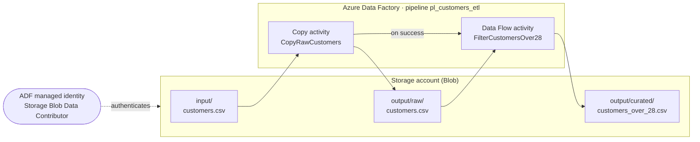

# azure-adf-etl-pipeline

A simple ETL pipeline built with **Azure Data Factory (ADF)** and **Azure Blob Storage**, deployed
entirely as code with **Bicep**.

The pipeline lands a raw customers CSV, then uses a **Mapping Data Flow** to keep only customers
older than 28 and writes the curated result as a new CSV.

## Purpose

This project is a hands-on deliverable for the goal *"Explore and enhance Cloud skills"*, as the
Azure counterpart of [aws-s3-lambda-file-processor](https://github.com/jempool/aws-s3-lambda-file-processor).
That project focuses on serverless code. This one focuses on the **data-engineering workflow**:

- **ETL orchestration**: a pipeline with two chained activities (Copy, then Data Flow).
- **Core ADF building blocks**: linked services, datasets, data flows and pipelines.
- **Transformations**: a Spark-backed Mapping Data Flow filter.
- **Secure connectivity**: ADF reaches storage through its **managed identity** and an RBAC role. No keys or connection strings are stored.
- **Infrastructure as code**: one declarative Bicep file, deployed and removed with one command each.
- **Monitoring**: pipeline and activity run details, including rows read and written, duration and billed compute.

## Architecture



1. `customers.csv` is uploaded to the `input` container.
2. The pipeline is triggered manually (there is no schedule, to avoid unexpected cost).
3. **CopyRawCustomers** (Copy activity) lands the file unchanged in `output/raw/`.
4. **FilterCustomersOver28** (Mapping Data Flow) reads the raw file, applies `filter(age > 28)`, and
   writes a single file, `output/curated/customers_over_28.csv`.
5. ADF Monitor (and the CLI) shows the status, duration and row counts of every activity.

### Data Flow

```
RawCustomers (source: id int, name, city, age int)
   └─► FilterOver28 (filter: age > 28)
          └─► CuratedCustomers (sink: single file customers_over_28.csv)
```

### Example

Input `input/customers.csv` (8 rows). It includes two customers aged exactly 28 to prove the
boundary is exclusive:

```csv
id,name,city,age
1,John,New York,30
2,Mary,Miami,25
3,Peter,Boston,40
4,Ana,Bogota,28
5,Luis,Medellin,29
6,Sofia,Lima,19
7,Carlos,Santiago,52
8,Emma,Chicago,28
```

Output `output/curated/customers_over_28.csv` (4 rows):

```csv
id,name,city,age
1,John,New York,30
3,Peter,Boston,40
5,Luis,Medellin,29
7,Carlos,Santiago,52
```

## Project structure

```
azure-adf-etl-pipeline/
├── infra/
│   ├── main.bicep          # All Azure resources: storage, containers, ADF, role assignment,
│   │                       #   linked service, datasets, data flow, pipeline
│   ├── common.ps1          # Shared names and Azure CLI helpers
│   ├── deploy.ps1          # Deploys main.bicep and uploads the sample CSV
│   ├── run-pipeline.ps1    # Runs the pipeline, waits, and saves evidence/
│   └── teardown.ps1        # Deletes the resource group (everything)
├── sample-data/
│   └── customers.csv       # Source data
└── evidence/               # Proof the pipeline works (see "Evidence" below)
```

## Azure resources

All resources live in one resource group (`rg-adf-etl-demo`, East US). A unique suffix is
derived from the resource group ID.

| Resource | Name | Purpose |
|---|---|---|
| Storage account | `stadfetl<suffix>` | StorageV2, LRS, no public blob access, TLS 1.2 |
| Blob containers | `input`, `output` | Source file; `raw/` and `curated/` results |
| Data Factory | `adf-etl-<suffix>` | Orchestration, with a system-assigned managed identity |
| Role assignment | Storage Blob Data Contributor | Lets the factory's identity read and write blobs |
| Linked service | `ls_blob_storage` | Connection to the storage account using the managed identity |
| Datasets | `ds_customers_input`, `ds_customers_raw`, `ds_customers_curated` | CSV (header row) locations |
| Data flow | `df_filter_customers_over_28` | Source, then filter `age > 28`, then a single-file sink |
| Pipeline | `pl_customers_etl` | Copy, then Data Flow (General compute, 8 cores, the smallest size) |

## Running it

Prerequisites: [Azure CLI](https://learn.microsoft.com/cli/azure/install-azure-cli) (Bicep is
installed with `az bicep install`), PowerShell, and `az login` to the target subscription.

```powershell
# Deploy infrastructure and upload sample data (safe to re-run)
.\infra\deploy.ps1

# Run the pipeline once and save evidence/ (takes about 5 minutes, mostly Spark cluster start-up)
.\infra\run-pipeline.ps1

# Delete everything when finished
.\infra\teardown.ps1
```

To explore it visually, open the Azure portal, go to **Data factories → adf-etl-&lt;suffix&gt; → Launch Studio**.
**Author** shows the pipeline and data flow, and **Monitor** shows the runs.

## Evidence

Captured from a real run on 2026-11-21 (subscription and tenant IDs redacted):

| File | Shows |
|---|---|
| [evidence/pipeline-run.json](evidence/pipeline-run.json) | Pipeline run `Succeeded` in about 4.5 minutes |
| [evidence/activity-runs.json](evidence/activity-runs.json) | Both activities `Succeeded`. Copy: 160 bytes read and written. Data Flow: **8 rows read, 4 rows written**, about 3 minutes of cluster start-up |
| [evidence/output/raw_customers.csv](evidence/output/raw_customers.csv) | Raw landing copy (8 rows) |
| [evidence/output/curated_customers_over_28.csv](evidence/output/curated_customers_over_28.csv) | Curated result (4 rows, both 28-year-olds excluded) |
| [evidence/output-container-listing.txt](evidence/output-container-listing.txt) | Contents of the `output` container after the run |
| [evidence/screenshots/](evidence/screenshots/) | ADF Studio and portal screenshots (see list below) |

Screenshots in `evidence/screenshots/`:

1. [adf-pipeline.png](evidence/screenshots/1.%20adf-pipeline.png): **Author → Pipelines → pl_customers_etl**, the Copy → Data Flow canvas.
2. [adf-dataflow.png](evidence/screenshots/2.%20adf-dataflow.png): **Author → Data flows → df_filter_customers_over_28**, the source → filter → sink graph, with the filter expression shown.
3. [adf-monitor-run.png](evidence/screenshots/3.%20adf-monitor-run.png): **Monitor → Pipeline runs**, the successful run with both activities green.
4. [adf-dataflow-details.gif](evidence/screenshots/4.%20adf-dataflow-details.gif): animated walkthrough of the Data Flow run details (eyeglasses icon), going through the three sections: **RawCustomers** (8 rows read), **FilterOver28** (4 rows kept), and **CuratedCustomers** (4 rows written).
5. [storage-output.png](evidence/screenshots/5.%20storage-output.png): Portal → storage account → **Containers → output**, showing `raw/` and `curated/`.
6. [storage-iam.png](evidence/screenshots/6.%20storage-iam.png): storage account → **Access control (IAM) → Role assignments**, showing the data factory as Storage Blob Data Contributor.

## Design decisions

- **Copy, then Data Flow (raw, then curated).** Landing the untouched file first is the standard
  "bronze, then silver" pattern. If a transformation is wrong, it can be re-run from `raw/` without
  re-ingesting the source.
- **A Mapping Data Flow for row filtering.** ADF's *Filter activity* only filters arrays in pipeline
  control flow, not rows in a file. Row-level transformations need a Data Flow (Spark).
- **Managed identity instead of keys.** The linked service has no secret. Access is granted with an
  Azure RBAC role on the storage account.
- **Bicep instead of portal clicks.** The whole factory, including the pipeline JSON, is reviewable
  and versioned, and is recreated identically with one command.
- **Cost guardrails.** Manual trigger only, the smallest Data Flow cluster (8 cores) that shuts down after
  each run, no debug sessions, and everything in one resource group that is deleted with one command.

## Cost

Measured from the run's billing data (the `billingReference` field in `activity-runs.json`):

| Item | Billed usage | Approx. cost at list price |
|---|---|---|
| Data Flow (General, 8 cores) | 0.51 core-hours | ~$0.14 |
| Copy activity | 0.067 DIU-hours | ~$0.02 |
| Orchestration and storage | 1 pipeline run, a few KB | < $0.01 |

That is **about $0.17 per pipeline run**, paid from the Azure free-account credit. Most of the Data
Flow cost is the roughly 3 minutes of Spark cluster start-up, not the processing itself.

## Lessons learned and possible applications

- **Data Flows have a fixed overhead.** About 3 minutes of cluster start-up and billed compute make
  them a poor fit for tiny, frequent files but good for batch transformations of larger data.
  For a few KB, a Copy activity or an Azure Function would be cheaper and faster.
- **Two gotchas hit while building this:**
  - The Copy activity rejects `quoteAllText: false` for CSV output.
  - A Data Flow sink writing to a dataset without a schema writes **0 columns** unless schema
    drift (auto-mapping) is enabled.
- **Managed identity plus RBAC** removes secrets from data pipelines entirely. The same pattern applies
  to SQL, Key Vault and other services.
- **Possible applications at Thinkbridge:** scheduled ingestion of client CSV/Excel exports into a
  data lake, cleansing and filtering before loading into Azure SQL or Synapse, and migrating legacy
  SSIS packages to ADF.
- **Next steps for a production version:** a schedule or storage-event trigger, parameterized
  file names, Git integration in ADF Studio, alerts on failed runs, and data-quality checks
  (for example, rejecting rows with a missing or invalid `age`).
